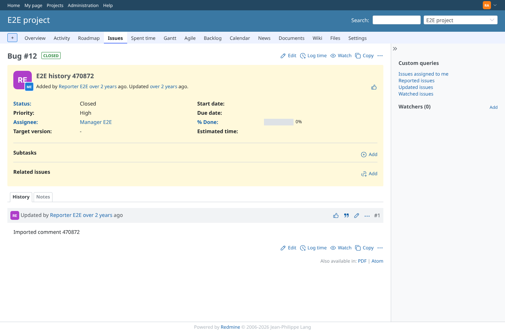
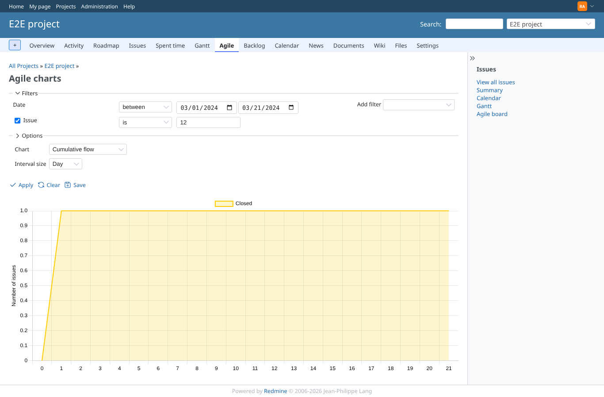
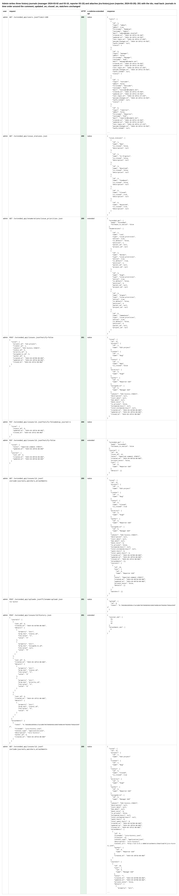
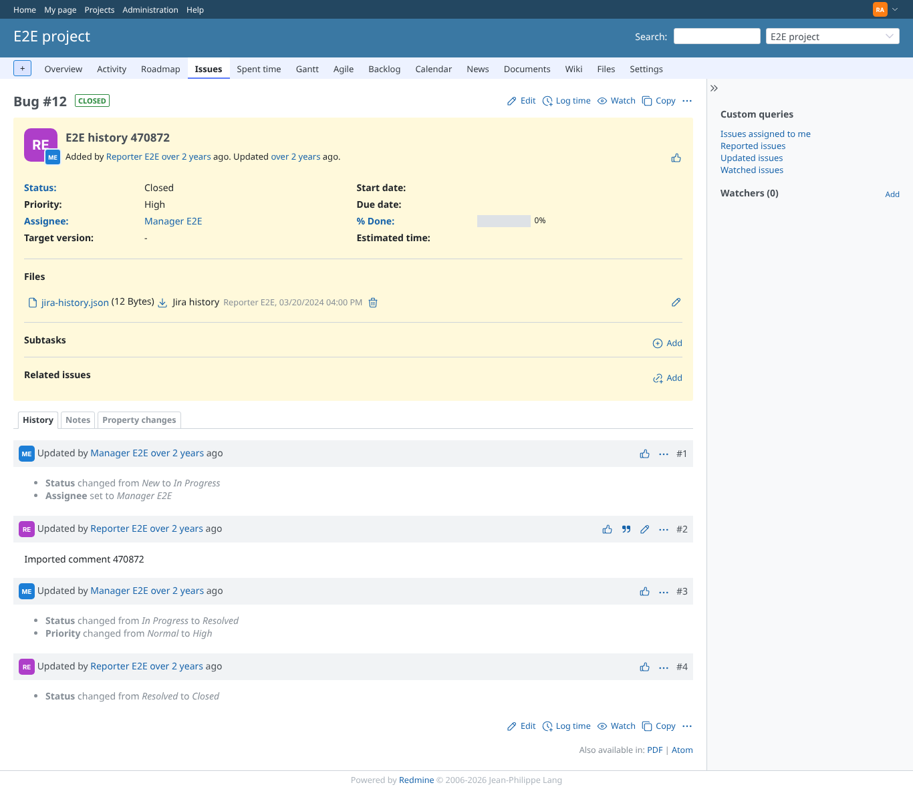
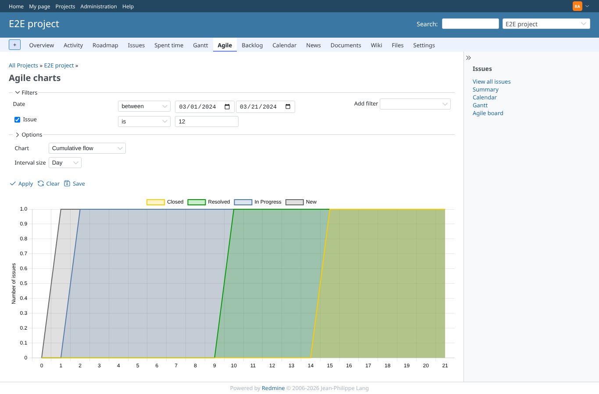
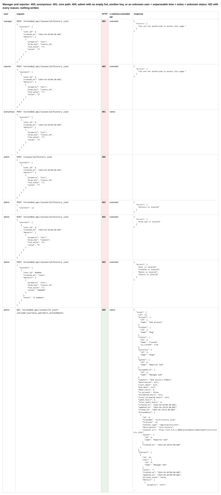

# issue-history

Run 2026-10-19T11:48:02.850Z against http://127.0.0.1:3000.

| screenshot | user | URL | shows |
|---|---|---|---|
|  | admin | `/issues/12` | Before: the imported issue (Closed) shows only the imported comment of 2024-03-05; updated 2024-03-20 |
|  | admin | `/projects/e2e-project/agile/charts?set_filter=1&f[]=status_id&op[status_id]=*&f[]=issue_id&op[issue_id]==&v[issue_id][]=12&f[]=chart_period&op[chart_period]=%3E%3C&v[chart_period][]=2024-03-01&v[chart_period][]=2024-03-21&chart=cumulative_flow&interval_size=day` | Before: redmine_agile's cumulative flow of the issue, 2024-03-01..21: Closed every day (no status history) |
|  | admin | `/projects/e2e-project/agile/charts?set_filter=1&f[]=status_id&op[status_id]=*&f[]=issue_id&op[issue_id]==&v[issue_id][]=12&f[]=chart_period&op[chart_period]=%3E%3C&v[chart_period][]=2024-03-01&v[chart_period][]=2024-03-21&chart=cumulative_flow&interval_size=day` | Admin writes three history journals (manager 2024-03-02 and 03-10, reporter 03-15) and attaches jira-history.json (reporter, 2024-03-20): 201 with the ids; read back: journals in time order around the comment, updated_on, closed_on, watchers unchanged |
|  | admin | `/issues/12` | After: the history shows the status, assignee and priority changes at their own time, by their own user, around the imported comment; still "Updated" 2024-03-20, jira-history.json by Reporter E2E |
|  | admin | `/projects/e2e-project/agile/charts?set_filter=1&f[]=status_id&op[status_id]=*&f[]=issue_id&op[issue_id]==&v[issue_id][]=12&f[]=chart_period&op[chart_period]=%3E%3C&v[chart_period][]=2024-03-01&v[chart_period][]=2024-03-21&chart=cumulative_flow&interval_size=day` | After: the cumulative flow follows the imported history: New on 03-01, In Progress from 03-02, Resolved from 03-10, Closed from 03-15 |
|  | admin | `/projects/e2e-project/agile/charts?set_filter=1&f[]=status_id&op[status_id]=*&f[]=issue_id&op[issue_id]==&v[issue_id][]=12&f[]=chart_period&op[chart_period]=%3E%3C&v[chart_period][]=2024-03-01&v[chart_period][]=2024-03-21&chart=cumulative_flow&interval_size=day` | Manager and reporter: 403; anonymous: 401; core path: 404; admin with an empty list, another key, or an unknown user + unparseable time + notes + unknown status: 422 with every reason; nothing written |
