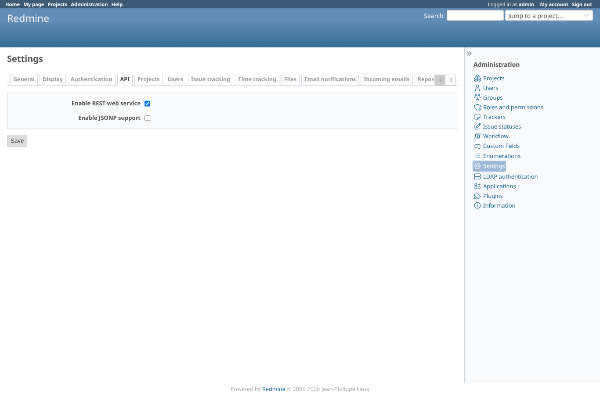
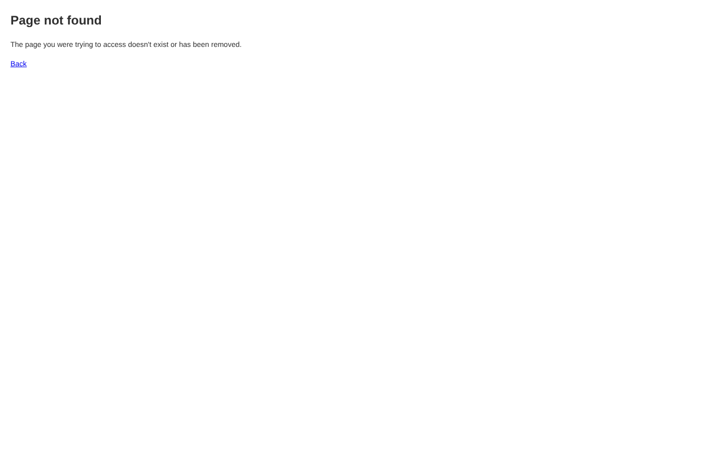

# webhooks

Run 2026-10-13T14:32:57.474Z against http://127.0.0.1:3061.

| screenshot | user | URL | shows |
|---|---|---|---|
|  | admin | `/settings?tab=api` | Redmine before 7.0: Settings > API has no webhook setting (the plugin runs without its webhook patch) |
|  | admin | `/webhooks` | Redmine before 7.0: /webhooks does not exist (404) |
