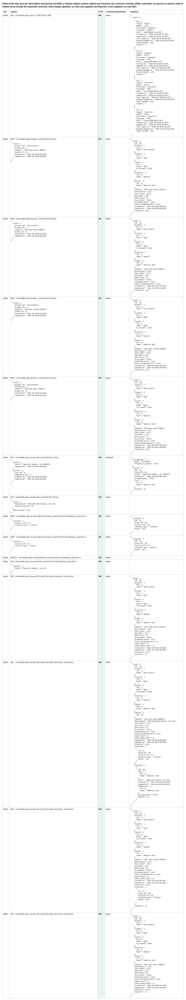
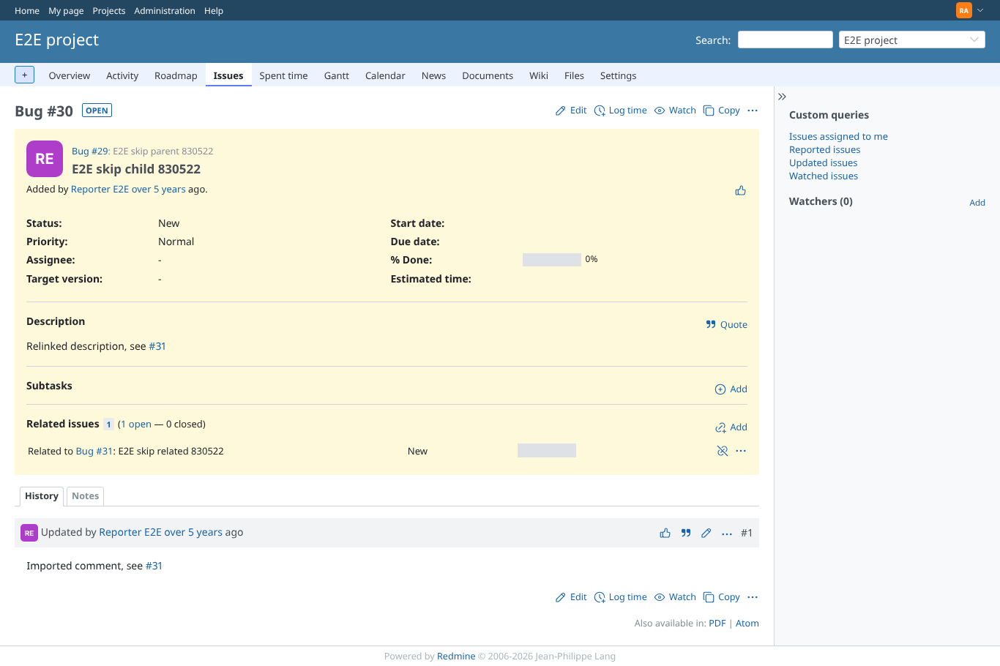
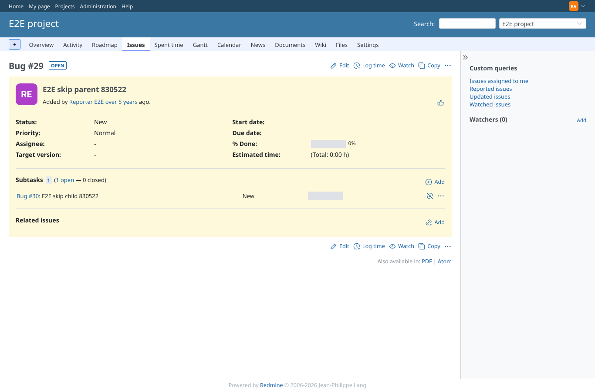
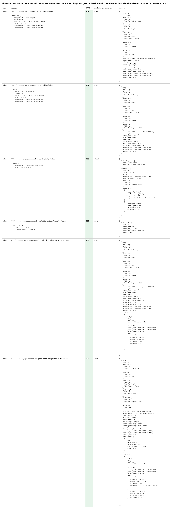
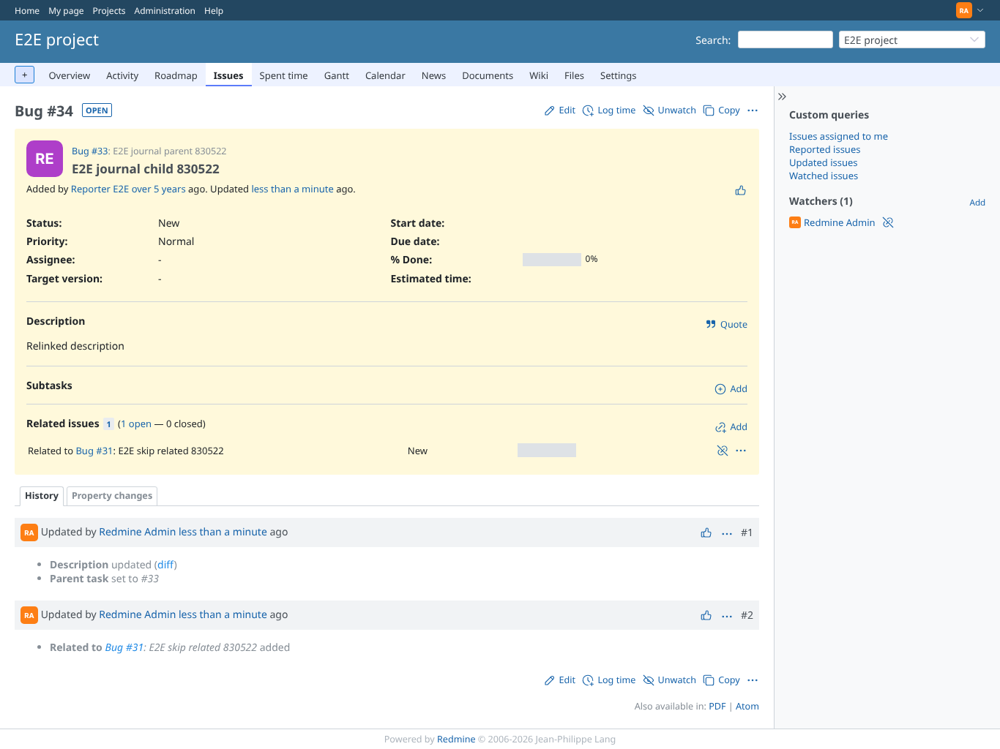
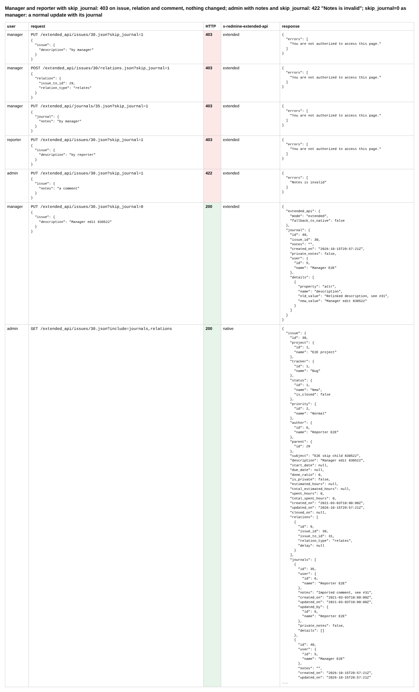
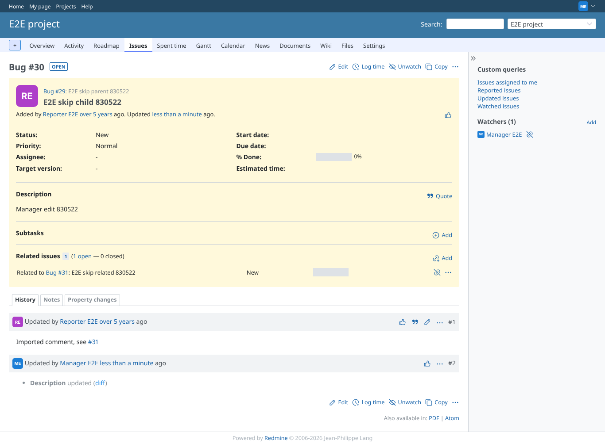

# skip-journal

Run 2026-10-15T20:57:24.281Z against http://127.0.0.1:3000.

| screenshot | user | URL | shows |
|---|---|---|---|
|  | admin | `/settings?tab=integrations` | Admin with skip_journal: description and parent set (204), a relation added, another added and removed, the comment rewritten (204); read back: no journal on parent, child or related issue except the imported comment, which keeps updated_on 2021 and updated_by Reporter; every updated_on still 2021 |
|  | admin | `/issues/30` | The child: parent, new description and relation shown; the history has only the imported comment by Reporter E2E, not marked edited; updated 2021 |
|  | admin | `/issues/29` | The parent: the subtask is listed, no "Subtask added" in the history, updated 2021 |
|  | admin | `/issues/29` | The same pass without skip_journal: the update answers with its journal, the parent gets "Subtask added", the relation a journal on both issues, updated_on moves to now |
|  | admin | `/issues/34` | Without the flag the child shows the update and the relation in its history, updated a moment ago |
|  | admin | `/issues/34` | Manager and reporter with skip_journal: 403 on issue, relation and comment, nothing changed; admin with notes and skip_journal: 422 "Notes is invalid"; skip_journal=0 as manager: a normal update with its journal |
|  | manager | `/issues/30` | The child seen by the manager after the refusals: only the imported comment and the manager's own edit (skip_journal=0) in the history |
